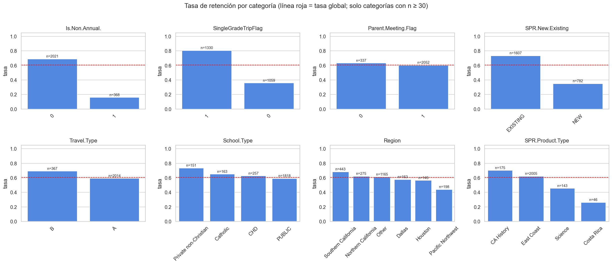
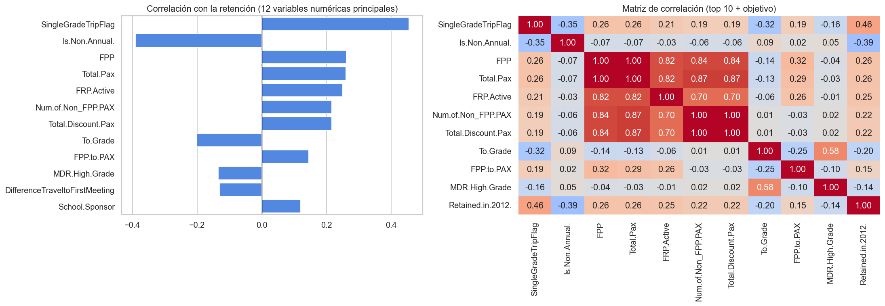
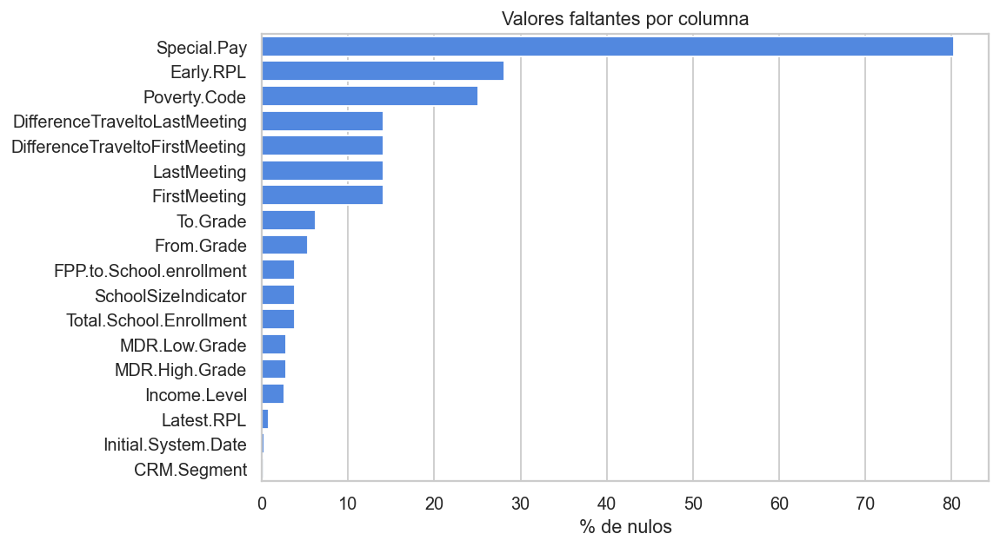

# EDA: retención de grupos escolares en Scholastic Travel Company


Proyecto académico de análisis exploratorio basado en el caso *Retention Modeling at Scholastic Travel Company (A)*. Analizo **2.389 grupos escolares** y **56 variables** (programa, grados, tipo de colegio, fechas de salida, precio, participantes, reuniones con padres y retención) para entender la calidad de los datos y qué factores se asocian con la **retención en 2012** (`Retained.in.2012.`).

## Hallazgos principales

La tasa global de retención es de **60,7 %**. Los factores con mayor asociación:

| Factor | Retención |
|---|---|
| Viaje de un solo grado vs. varios grados | 80,6 % vs. 35,8 % |
| Programa anual vs. no anual | 68,9 % vs. 16,0 % |
| Cliente existente vs. nuevo | 73,3 % vs. 34,9 % |
| Existente + un solo grado | 85,5 % |
| Nuevo + varios grados | 22,5 % |
| Cuartil de mayor tamaño de grupo vs. el menor (`Total.Pax`) | 80,5 % vs. 40,4 % |

Las reuniones con padres (`Parent.Meeting.Flag`) casi no muestran relación con la retención (V de Cramér = 0,02). Son asociaciones descriptivas, no causales.





## Calidad de datos

- **Nulos estructurales:** los 337 nulos de `FirstMeeting`, `LastMeeting` y sus diferencias de días corresponden exactamente a los grupos con 0 reuniones con padres. No los imputo, porque la mediana inventaría fechas que nunca existieron.
- **Fechas:** convierto a fecha las 8 columnas en formato serial de Excel.
- **Redundancia:** `Tuition` y `SPR.Group.Revenue` son idénticas en el 100 % de las filas; `Total.Pax` es igual a `FPP` + `Num.of.Non_FPP.PAX`, y `Num.of.Non_FPP.PAX` es idéntica a `Total.Discount.Pax`.
- **Posibles errores de captura:** 1 grupo (ID 1575) con depósito posterior a la salida, y 322 grupos (13,5 %) donde `Days` no coincide con las fechas.
- No hay filas duplicadas y los IDs son únicos.



## Metodología

1. Carga y vista general
2. Diagnóstico de valores faltantes (¿aleatorios o estructurales?)
3. Limpieza sin imputar en el EDA
4. Validación de consistencia (reporto, no borro en silencio)
5. Análisis univariado y de asimetría
6. Outliers con la regla del rango intercuartílico (los cuantifico, no los elimino)
7. Relación con la variable objetivo: tasas de retención, V de Cramér y correlaciones
8. Reporte automático (ydata-profiling) y exportación del dataset curado

## Contenido del repositorio

| Archivo | Descripción |
|---|---|
| `EDA.ipynb` | Notebook con todo el análisis, comentado paso a paso |
| `imagenes/` | Gráficos principales generados por el notebook |
| `requirements.txt` | Dependencias |

## Cómo ejecutarlo

1. Obtén los datos del caso (ver la sección siguiente) y guarda el CSV en la misma carpeta del notebook, con el nombre `03 CSV data -- STC(A)_numerical dates.csv`.
2. Instala las dependencias y abre el notebook:

```bash
git clone https://github.com/danielcaru1-lab/eda-scholastic-travel-retention.git
cd eda-scholastic-travel-retention
pip install -r requirements.txt
jupyter notebook EDA.ipynb
```

Al ejecutarlo se generan `data_curada.csv`, `eda_report.html` (reporte de ydata-profiling en modo mínimo) y los gráficos de `imagenes/`. Para el reporte completo, cambia `minimal=True` por `minimal=False` en la última sección.

## Fuente de los datos

Ovchinnikov, A. S. (2017). *Retention Modeling at Scholastic Travel Company (A)* (UVA-QA-0864). Darden School of Business, University of Virginia. Darden Business Publishing: https://store.darden.virginia.edu/retention-modeling-at-scholastic-travel-company-a

El caso y sus datos son propiedad de Darden Business Publishing y se distribuyen bajo derechos de autor, por lo que **no se incluyen en este repositorio**. Este proyecto es un trabajo académico propio sobre ese material.

## Autor

**Daniel Camelo** · [GitHub](https://github.com/danielcaru1-lab) · [LinkedIn](https://www.linkedin.com/in/daniel-fernando-camelo-ruiz)
